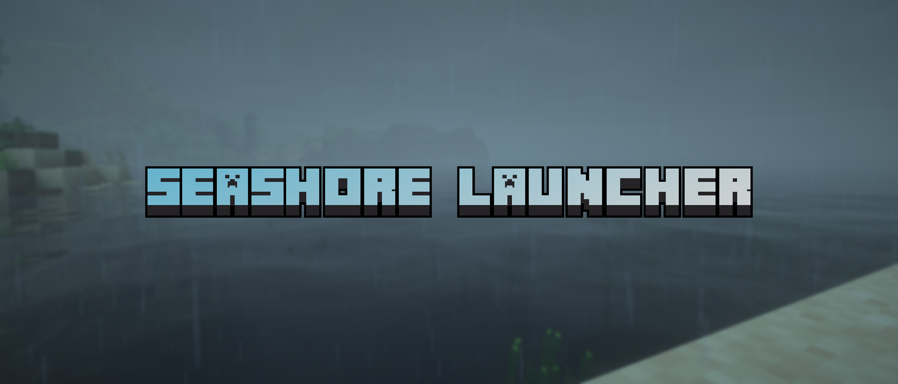

# Seashore Launcher - 远古 Minecraft Android 启动器 (Legacy Minecraft Android Launcher)

`Seashore Launcher` 是一个**面向 Minecraft 早期历史版本（Pre-Classic、Classic、Indev、Infdev、Alpha、Beta 直至 b1.8 / 1.5.2）的 Android 特化启动器**——在手机上跑官方启动器早已不再提供、桌面端由姊妹项目 Attic 覆盖的那段历史。执行栈继承 [Quanta-Craft-Launcher (QCL)](https://github.com/ALLEN201123/Quanta-Craft-Launcher)（Pojav 后端 + CaciCavallo AWT + 捆绑 OpenJDK 移植 + GL→GLES 转译），以**减法特化**砍掉现代版本支持。

**当前处于调研期**：Phase 0 已收口（2026-10-31），Phase 1 脚手架未开工，暂无可安装构件。

名字取自"海岸"：远古版本是被主流潮水留在滩涂上的贝壳，这个项目负责把它们拾回来——与桌面端"阁楼（Attic）"同一收藏观。

<p align="center"></p>

> **免责声明**：本项目是独立开发的第三方开源启动器，并非 Minecraft 官方产品，未获 Microsoft、Mojang Studios 或任何第三方平台的赞助、认可或背书。
> *Independently developed third-party open-source launcher. Not an official Minecraft product; not approved or endorsed by Microsoft or Mojang Studios.*

它的核心理念是**基座继承 + 减法特化 + 跨仓通道复用**：

```text
基座供给（QCL，GPL-3.0）                  通道复用（Attic 桌面仓，数据与语义）
├── Pojav 执行栈 + SDL3 + CaciCavallo     ├── Betacraft 端点 / 版本表
├── 捆绑 OpenJDK 移植（jre8）+ lwjglx     ├── legacyfix fork 补丁矩阵
└── 远古 258 版安装链 + 全远古中文补丁     └── agentMount 决策 / 死链声音物化
            ↓                                        ↓
   Seashore 只做三件事：砍现代版本支持 · 品牌身份自建 · 渲染修复（fork Krypton 基座）
```

> **戒律**：与 QCL 的关系 = **cherry-pick 非 rebase**——QCL 定位全能，纯远古减法提上游必被拒，分叉是产品定义使然，非违纪。GPL 血脉允许代码与 UI 布局继承，**不自动允许商标**：名字与图标等品牌资产自建。

完整调研纪要见 [research/qcl-android-shell.md](./research/qcl-android-shell.md)，分阶段计划见 [plan.md](./plan.md)。

---

## 🌟 技术要点

- **远古版本全谱系**：继承 QCL 的 258 枚考古归档版本下载与骨 JSON 模板安装链（`LegacyArchiveInstallTask`），数据端点与 Attic 桌面仓同源（Betacraft 档案快照）；全远古中文补丁（逐版混淆名表）随基座移植。
- **渲染器线（2026-11-01 定调，§34/§35，已迁独立仓 Seashore-Renderer）**：不追自研——fork **Krypton（NG-GL4ES，MIT）**出"Seashore 渲染器"条目。远古特化后渲染需求只剩 GL 1.x/2.x 固定管线 → GLES，现成转译层够用；QCL 卡死的自研渲染器恰属被砍的现代层。
- **渲染三案已取证定罪（§31-§35）**：天空/classic 色块 = gl4es `glInterleavedArrays(GL_C3F_V3F)` 步长上游 typo（`vert=4` 应 3），一行修复已 AVD 终验；阴影三角（0611~b1.7.3）= 游戏预三角化零法线重复顶点，属数据侧修复（映射表 / `-Dlf.gl4esquad`）；间歇崩溃 = listdraw EBO sizeof，Krypton 已修。**"第三方转译天花板"论不成立**。
- **修复件挂载**：legacyfix fork（`-javaagent`）+ Seashore 映射表方案（表扩双家族）；启动语义与补丁语义解耦——直调主类 + javaagent 直连，不走 launchwrapper（§16）。
- **UI 与品牌**：布局沿用 FCL 血脉（GPL-3.0 允许，可微调）；名字、图标、包名（`com.qcl.launcher` → Seashore 命名空间）自建。

---

## 🧭 开发状态

| 阶段 | 内容 | 状态 |
|---|---|---|
| 调研期 | QCL 画像 / 数据层 / AWT 平台税 / 渲染器取证 | ✅ Phase 0 已收口（2026-10-31，纪要 §1-§16）；渲染三案定罪（§31-§35） |
| 闸门一 | legacyfix `-javaagent` 上 Android 存活面 | ✅ 已闭环：存活面收敛为游戏侧补丁 + 网络代理，渲染层零触碰（§14/§16） |
| 闸门二 | 减法可行性依赖图审计 | 🔄 转入 Phase 2 |
| Phase 1 | 基座落库 + 品牌剥离 + x86_64 AVD 脚手架 | 📋 未开工 |
| Phase 2 | 减法特化（收敛 Pre-Classic → b1.8/1.5.2） | 📋 未开工 |
| 渲染器 Fork 线 | fork Krypton → 直移 `vert=4→3` → 扩 ABI 内置 | ➡️ 已迁出独立仓 [CreatorCSIE/Seashore-Renderer](https://github.com/CreatorCSIE/Seashore-Renderer)（工单见其 plan.md）；主仓仅留 Phase 1 内置/注册接口 |

---

## 💻 开发环境要求

- **Android Studio + SDK + x86_64 system image**（≈ 15-20GB）；Windows 走 WHPX（Hyper-V 平台，HAXM 已弃用）；AVD 内存 4GB+。
- **Gradle 构建需 JDK 17+**（壳构建侧；游戏侧捆绑 jre8 移植，两者无关）。
- **主力开发台 = x86_64 AVD**（硬件虚拟化近原生 CPU，`-gpu host`）；真机（任意 arm64 旧手机/盒子）= 发版 sanity，**非前置门槛**（决策全量见纪要 §9）。
- 渲染器 fork 线（独立仓 Seashore-Renderer）是唯一碰 NDK 的线（NDK ≥r26，CMake；r30）；壳侧维持 **fork 期零 NDK**（`abiFilters 'x86_64'`）。

---

## 🚀 仓库结构与参考件获取

Phase 1 未开工，暂无构建命令。仓库结构：

```text
Seashore-Launcher
├── plan.md                      分阶段计划（Phase 0 收口 / Phase 1 脚手架 / Phase 2 减法 + 渲染器 Fork 线工单）
├── research/qcl-android-shell.md 调研纪要卷宗（§1-§35：QCL 画像、数据层、启动链、渲染三案取证定罪）
├── docs/                        banner 等品牌资产
├── reference/                   上游源码稀疏检出（QCL / FCL / Pojav / legacyfix / gl4es / NG-GL4ES，gitignore 不入库）
└── build/                       取证判读脚本与构件（gitignore 不入库）
```

`reference/` 大仓不全拉资产，本地稀疏检出方式：

```bash
git clone --depth 1 --filter=blob:none --no-checkout <url> reference/<name>
git -C reference/<name> sparse-checkout set --no-cone '<源码目录模式>'
git -C reference/<name> checkout -f
```

---

## 🌐 Localization / 国际化

界面继承 QCL/FCL 中文血脉，并规划随基座移植全远古版本汉化资产（逐版混淆名表 + 翻译表，纪要 §2）。
*The UI follows the QCL/FCL Chinese lineage; per-version Chinese localization for legacy releases is planned alongside the base migration.*

---

## ❓ 常见问题（FAQ）

### Q1：现在能装能用吗？

不能。当前是调研期，仓库无 APK。第一个可安装形态 = Phase 1 脚手架（行为等价 QCL 1.5.7 现状的 Seashore 骨架）。

### Q2：和 QCL 什么关系？为什么不直接给 QCL 提 PR？

继承 + 减法：QCL 定位全能（现代版至 26.x + 远古特化），Seashore 只做纯远古——减法特化提上游必被拒，所以分叉独立新项，纪律 = cherry-pick 非 rebase。渲染根因与修复素材会另行反哺上游（gl4es/Krypton 侧）。

### Q3：和 Attic-Minecraft-Launcher 什么关系？

姊妹仓。跨仓复用 = 数据与通道（Betacraft 端点、版本表、legacyfix 补丁矩阵、决策表），**不复用代码和 UI**；两仓共享同一非目标（1.6+ 不做）。

### Q4：支持 1.6 及以上版本吗？

不做。目标谱系 Pre-Classic → b1.8/1.5.2，与桌面端 Attic 同一非目标——那段历史官方启动器已覆盖好。

### Q5：远古版在手机上色块/天空三角/阴影三角，QCL README 说是"所有第三方转译的天花板"？

两案均已根因定位且可修，**不是天花板**：色块/天空三角 = gl4es 上游一行步长 typo（`GL_C3F_V3F vert=4` 应 3，§32/§33，已修复终验）；阴影三角 = 游戏自身预三角化产生零法线重复顶点的数据 bug（§35，GL4ES-Fix 语义翻转即愈，与渲染器无关）。详见纪要 §31-§35。

---

## 📄 许可证与版权声明 (License & Copyright)

- 本项目仅供 Minecraft 历史版本研究、怀旧与技术交流使用。
- 为了防止代码被恶意倒卖、闭源修改或注入恶意软件，本项目源码采用 **[GNU General Public License v3 (GPL v3) 许可证](LICENSE)** 进行强制开源。
  - **Copyright (c) 2026 CreatorCSIE. All rights reserved.**
- **血脉致谢与合规**：规划继承 QCL / FCL / PojavLauncher / legacyfix / caciocavallo / LWJGL / GL4ES 等上游成果（均 GPL-3.0 或兼容许可），LICENSE 与 THIRD_PARTY_NOTICES 义务原样带走，立项后建立 `THIRD_PARTY_NOTICES.md` 完整列明。
- **第三方资产与商标免责声明**：
  - `reference/` 下的上游源码仅作本地研究用途，不随本仓库分发。
  - Minecraft 游戏资产、商标与品牌版权（含 Mojang/Betacraft 构件）归 **Mojang Studios / Microsoft** 及相关权利方所有，本仓库零入库、零分发。
