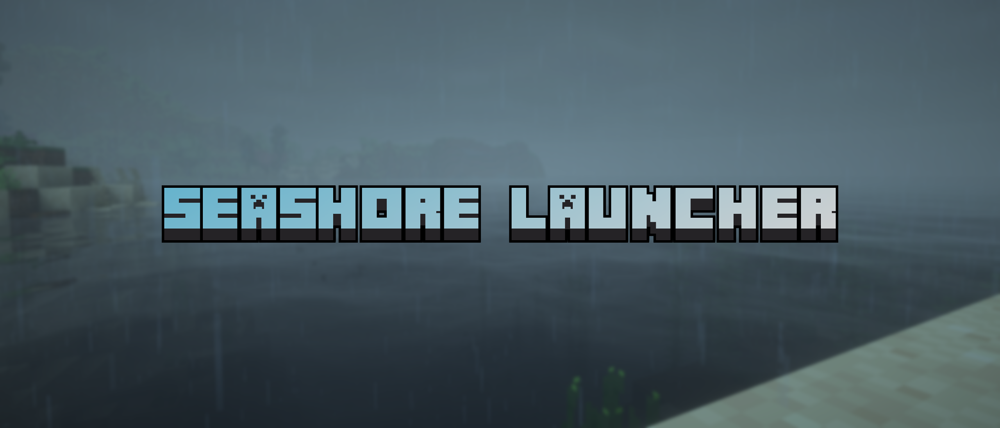

<p align="center"></p>

# Seashore-Launcher

> 远古 Minecraft（Pre-Classic → b1.8/1.5.2）Android 特化启动器 —— **调研期**。

## 定位

- 继承 [Quanta-Craft-Launcher (QCL)](https://github.com/ALLEN201123/Quanta-Craft-Launcher) 的远古版落地经验与 GPL 执行栈（Pojav 后端 + CaciCavallo AWT 后端 + 捆绑 OpenJDK 移植 + 第三方 GL→GLES 转译），**减法特化砍掉现代版本支持**（与桌面端 [Attic-Minecraft-Launcher](https://github.com/CreatorCSIE/Attic-Minecraft-Launcher) 同一非目标）。
- 与 Attic 桌面仓的关系 = 跨仓**通道复用**（数据与语义，非代码非 UI）：Betacraft 端点/版本表、agentMount 决策表、legacyfix fork 补丁矩阵、死链声音物化技巧。
- 纯远古特化后渲染需求只剩 GL 1.x/2.x 固定管线 → GLES，GL4ES/Krypton 现成够用——QCL 卡死的自研渲染器恰属被砍的现代层。
- UI 布局沿用 FCL 血脉（GPL-3.0 允许，可微调）；**名字与图标等品牌资产自建**（GPL 允许代码，不自动允许商标）。

## 状态

- [ ] 调研期。调研纪要见 [research/qcl-android-shell.md](research/qcl-android-shell.md)。
- [ ] 闸门一：`-javaagent:legacyfix.jar` 塞进 QCL/FCL 启动参数跑 b1.7.3/infdev，读 `Patches:` 状态表（验证 legacyfix 修复语义在 Android 的存活面）。
- [ ] 闸门二：减法可行性审计——现代/远古在启动主链的分支点依赖图证据。
- **开发/测试平台**：x86_64 AVD 主力开发台（`abiFilters 'x86_64'`、零 NDK）；真机 = 发版 sanity，非前置门槛（决策全量见调研纪要 §9）。
- [ ] **渲染器线（新立）**：不等 QCL 自研，先用现有 GL4ES 攻其"远古版颜色异常天花板"（三渲染器对照复现 + EGLConfig 取证，见调研纪要 §10）；自研作后续。
- [ ] plan.md 待调研收敛后建立（目前不落）。

## 上游参考（`reference/`，gitignore 不入库）

| 仓库 | 说明 |
| --- | --- |
| `Quanta-Craft-Launcher` | 基座候选（GPL-3.0，活跃，分支 1.5.7）；远古 258 版数据层 + 全远古中文补丁 |
| `FoldCraftLauncher` | QCL 的参照上游（GPL-3.0，UI 血脉源头） |
| `PojavLauncher` | 执行栈源头（**已停更**，归档参照） |
| `legacyfix` | 修复标准件（GPL-3.0，v3 分支）；fork 补丁矩阵见 Attic 侧定稿 |

本地稀疏检出方式（大仓不全拉资产）：

```bash
git clone --depth 1 --filter=blob:none --no-checkout <url> reference/<name>
git -C reference/<name> sparse-checkout set --no-cone '<源码目录模式>'
git -C reference/<name> checkout -f
```

## 许可证与版权声明

- 源码采用 **[GNU General Public License v3 (GPL-3.0)](LICENSE)**。
  - **Copyright (c) 2026 CreatorCSIE. All rights reserved.**
- 血脉致谢与合规：本项目规划继承 QCL / FCL / PojavLauncher / legacyfix / caciocavallo / LWJGL / GL4ES 等上游成果（均 GPL-3.0 或兼容许可），立项后将建立 `THIRD_PARTY_NOTICES.md` 完整列明；`reference/` 下上游源码仅作本地研究用途，不随本仓库分发。
- Minecraft 游戏资产、商标与品牌版权（含 Mojang/Betacraft 构件）归 **Mojang Studios / Microsoft** 及相关权利方所有，本仓库零入库、零分发。
